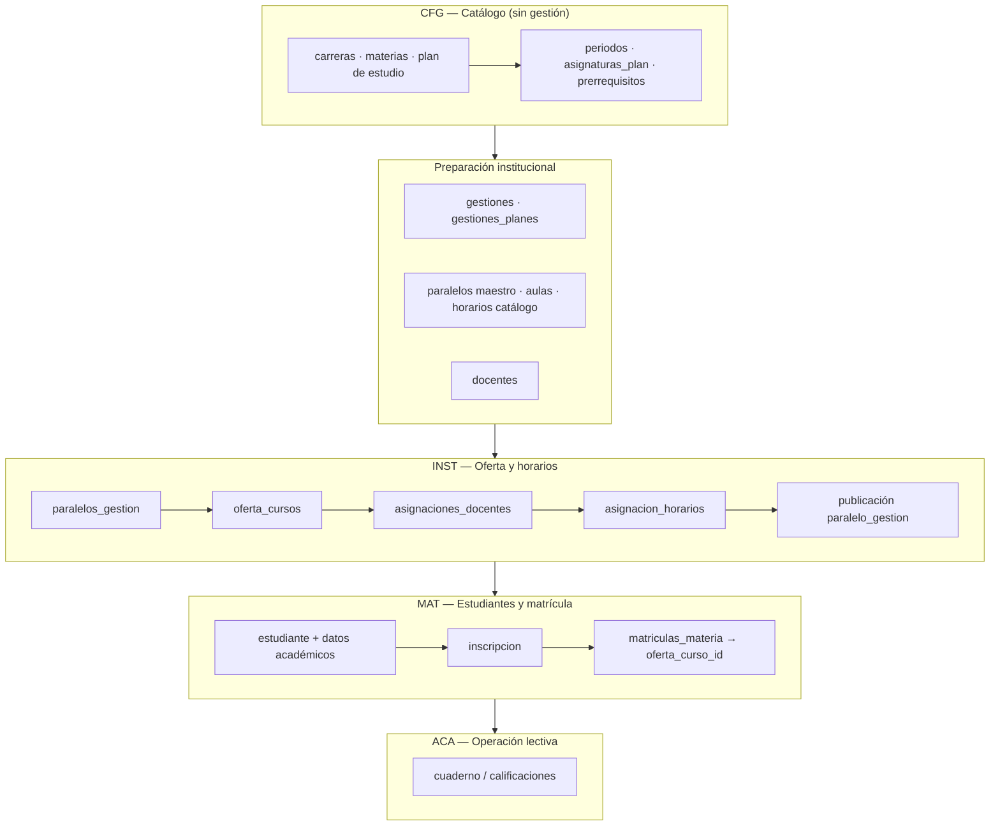

# Flujo operativo — gestión académica completa

**Propósito:** guía permanente para probar el ciclo académico de punta a punta, pantalla por pantalla, alineada al schema actual y al menú del frontend.

**Audiencia:** desarrollo, QA y coordinación académica que valida el sistema tras el refactor de oferta + horarios (Sprints 1–5).

**Referencias cruzadas:** `backend/database/01-schemas/` y `CLAUDE.md` (decisiones de modelo; el antiguo `PLAN_MAESTRO.md` ya no existe), `docs/referencia/matriz-permisos-sistema.md` (permisos por pantalla).

---

## 1. Resumen: qué va primero

El orden de negocio **no** sigue el orden del menú lateral. Sigue la cadena de dependencias de datos:

**Regla práctica:** no matricular estudiantes ni abrir cuadernos hasta que exista **oferta publicada con horario** para el paralelo-gestión elegido.

### Flujo resumido por dominio del menú

| Fase | Dominio | Rutas clave | Objetivo |
|------|---------|-------------|----------|
| 1 | **CFG** (8) | `/configuracion/academico?tab=planes` | Carreras, materias, plan, periodos, asignaturas |
| 2 | **DOC** (4) | `/docentes/listar`, `/docentes/registrar`, `/docentes/asignar` | Docentes con color, límites de carga y **vínculo materia ofertada** (sin grilla horaria) |
| 3 | **INST** (6) | `/institucional/oferta` | Habilitar plan → `paralelos_gestion` → `oferta_cursos` → OFERTADO |
| 4 | **INST** | `/institucional/horarios/*` | Matriz docente, **armado de bloques**, conflictos, publicación |
| 5 | **MAT** (2) | `/estudiantes/registrar`, `/matricula/nueva` | Admisión + inscripción + `matriculas_materia` |
| 6 | **ACA** (3) | `/academico/calificaciones/mis-cursos/...` | Cuaderno y notas |

---

## 2. Cadena canónica de tablas

| Paso | Tabla(s) | Rol |
|------|----------|-----|
| Catálogo | `carreras`, `materias`, `planes_estudios`, `periodos`, `asignaturas_plan`, `prerrequisitos` | Qué se enseña; sin año lectivo |
| Gestión | `gestiones`, `gestiones_planes` | Qué plan se habilita en qué año |
| Infraestructura | `paralelos`, `aulas`, `horarios`, `docentes` | Maestros reutilizables |
| Oferta | `paralelos_gestion`, `oferta_cursos` | Paralelo concreto en la gestión + materias ofertadas |
| Docencia | `asignaciones_docentes`, `asignacion_horarios` | Quién dicta y en qué bloque/aula |
| Matrícula | `inscripciones`, `matriculas_materia` | Estudiante en gestión; materias que cursa |
| Notas | `bimestres_matricula`, evaluaciones (ver `15-evaluaciones.sql`) | Registro de calificaciones |

**Ancla estable para el estudiante:** `matriculas_materia.oferta_curso_id` no cambia aunque se reasigne el docente.

---

## 3. Pre-requisitos antes de probar

1. **Base de datos:** schemas `01-schemas/` ejecutados en orden (05 → 09 antes de 13-inscripciones).
2. **Seeders locales:** catálogo académico, gestión vigente, aulas, bloques horarios, paralelos maestro, docentes de prueba (seeders 27–48 según entorno).
3. **Usuario de prueba:** rol con permisos de coordinación (p. ej. `DIR_ACADEMICO` o `ADMIN_SISTEMA`). Ver matriz de permisos.
4. **Servicios:** backend + frontend en marcha; login exitoso.

---

## 4. Flujo página por página (smoke E2E)

Cada fila indica: **dominio del menú** → **ruta** → **qué validar** → **tablas tocadas**.

Leyenda estado UI: ✅ implementado · 🚧 `UnderConstruction` (no bloquea el flujo principal si hay seeders/API).

---

### Fase 0 — Seguridad (opcional al inicio)

| # | Menú | Ruta | Acción | Verificación |
|---|------|------|--------|--------------|
| 0.1 | **SEG** → Usuarios | `/seguridad/usuarios` | Crear usuario operativo | Usuario puede iniciar sesión |
| 0.2 | **SEG** → Roles | `/seguridad/roles` | Revisar permisos del rol de prueba | Menús visibles = permisos en seed 55 |

---

### Fase 1 — CFG: catálogo académico (sin gestión)

> Menú raíz: **Configuración** (`CFG`, order 8 en sidebar).

| # | Menú | Ruta | Acción | Verificación | Tablas |
|---|------|------|--------|--------------|--------|
| 1.1 | **CFG** → Académico | `/configuracion/academico?tab=carreras` | Listar / crear carrera | Carrera visible en tab | `carreras` |
| 1.2 | CFG → Académico | `/configuracion/academico/carrera/nueva` | Alta carrera | Detalle accesible | `carreras` |
| 1.3 | CFG → Académico | `/configuracion/academico?tab=materias` | Listar / crear materia | Sigla única operativa | `materias` |
| 1.4 | CFG → Académico | `/configuracion/academico?tab=planes` | Crear plan, marcar vigente | Plan con RM, horas semanales | `planes_estudios` |
| 1.5 | CFG → Académico (tab Planes) | mismo tab | Definir periodos (1º–3º año) | Periodos ordenados | `periodos` |
| 1.6 | CFG → Académico (tab Planes) | mismo tab | Asignar materias por periodo | Horas semanales por asignatura | `asignaturas_plan` |
| 1.7 | CFG → Académico (tab Planes) | mismo tab | Prerrequisitos (si aplica) | Validación futura en matrícula | `prerrequisitos` |

**Complementos recomendados (paralelos al catálogo):**

| # | Menú | Ruta | Estado |
|---|------|------|--------|
| 1.8 | CFG → Documentación | `/configuracion/documentacion` | ✅ Requerido para admisión |
| 1.9 | CFG → Complementarios | `/configuracion/datos-complementarios` | ✅ Discapacidad, catálogos |
| 1.10 | CFG → Actividades | `/configuracion/actividades` | 🚧 Calendario académico futuro |

**Criterio de cierre Fase 1:** existe al menos un **plan vigente** con todas las `asignaturas_plan` del periodo que se ofertará.

---

### Fase 2 — DOC: docentes (ficha, color, carga y vínculo con materias)

> Menú raíz: **Docentes** (`DOC`, order 4).  
> **Alcance de este dominio:** ABM del docente, identidad visual (`color_hex`), límites de carga y **vincular materias ofertadas** (`oferta_cursos` → `asignaciones_docentes`).  
> **No incluye:** armado de bloques semanales ni publicación de horarios — eso es **Fase 4** (`/institucional/horarios/*`).

| # | Menú | Ruta | Acción | Verificación | Tablas |
|---|------|------|--------|--------------|--------|
| 2.1 | **DOC** → Docentes | `/docentes/listar` | Listar docentes | Columna color + carga asignada / máximo | `docentes`, vistas carga |
| 2.2 | DOC | `/docentes/registrar` | Alta docente | CI, contacto, `max_horas_semana` / `max_horas_mes`, color | `docentes` |
| 2.3 | DOC → detalle | `/docentes/:id` | Asignar **color** único | Swatch en ficha; se usa en grilla Institucional | `docentes.color_hex` |
| 2.4 | DOC → detalle | `/docentes/:id` | Tab **Materias asignadas** | Lista vínculos sin calendario semanal | `asignaciones_docentes` |
| 2.5 | **INST** → Oferta académica | `/institucional/oferta` | Asignar docente por **oferta** (modal en ficha del paralelo) | Vínculo vigente por `oferta_curso_id` | `asignaciones_docentes` |
| 2.6 | **INST** → Resolver conflictos | `/institucional/horarios/conflictos` | Grilla semanal del docente; mover bloques en choque | Reubicar `asignacion_horarios`; no listado de tarjetas | `asignacion_horarios` |

**Criterio de cierre Fase 2:** al menos un docente activo con color, límites de carga definidos y **una asignación docente por materia** que se dictará en la prueba (sin exigir bloques horarios aún).

---

### Fase 3 — INST: oferta académica

> Menú raíz: **Institucional** (`INST`, order 6).

| # | Menú | Ruta | Acción | Verificación | Tablas |
|---|------|------|--------|--------------|--------|
| 3.1 | **INST** → Gestión actual | `/institucional/actual` | ✅ Ver gestión vigente + **Activar cursado** (inicia bimestres, INSCRITO→CURSANDO) | Estado de cursado visible; botón con `academico.calificacion.gestion_bimestres` EDITAR | `gestiones`, `matriculas_materia`, `bimestres_matricula` |
| 3.2 | INST → Cronogramas | `/institucional/cronogramas` | 🚧 | Periodos académicos vía seed/API | `periodos_academicos` |
| 3.3 | **INST** → Oferta Académica | `/institucional/oferta` | **Paso 1:** elegir gestión | Gestión vigente seleccionada | `gestiones` |
| 3.4 | Oferta (paso 2) | `/institucional/oferta` | Habilitar plan en gestión | Plan en estado VIGENTE/APROBADO | `gestiones_planes` |
| 3.5 | Oferta (paso 3) | `/institucional/oferta` | Generar **paralelos de gestión** | Filas `paralelos_gestion` | `paralelos_gestion` |
| 3.6 | Oferta (paso 3) | mismo | Turno + aula base + cupos | Turno efectivo ≠ solo maestro | `paralelos_gestion` |
| 3.7 | Oferta (paso 3) | mismo | **Generar oferta** por paralelo | Badge ✓ N/N asignaturas | `oferta_cursos` |
| 3.8 | Oferta (paso 3) | mismo | Pasar paralelo a **OFERTADO** | Estado listo para matrícula | `paralelos_gestion.estado` |

**Criterio de cierre Fase 3:** cada paralelo-gestión de prueba tiene `oferta_cursos` completos (una fila por `asignatura_plan` del periodo del paralelo).

---

### Fase 4 — INST: horarios (bloques) y publicación

> Entrada: **Institucional** → **Gestión de Horarios** (`/institucional/horarios`).  
> **Prerrequisito:** Fase 3 (oferta) y vínculos docente–materia (Fase 2 o matriz 4.2). Aquí se **cubren horas** con bloques en la grilla, no se elige la materia del plan.

| # | Sub-flujo | Ruta | Acción | Verificación | Tablas |
|---|-----------|------|--------|--------------|--------|
| 4.1 | Tablero horarios | `/institucional/horarios` | Ver paralelos por estado | BORRADOR / OFERTADO / PUBLICADO | `paralelos_gestion` |
| 4.2 | Asignación docente (matriz) | `/institucional/horarios/asignacion-docente` | Revisar / ajustar docente por **oferta** | Coherente con `asignaciones_docentes` | `asignaciones_docentes` |
| 4.3 | Asignación docente | mismo | Color y totales de carga | No exceder `max_horas_semana` | `docentes` |
| 4.4 | Carga docentes | `/institucional/horarios/carga-docentes/:gestionId` | Tabla resumen carga | Chips / totales por docente | vistas 59+ |
| 4.5 | Armado grilla | `/institucional/horarios/armado?pg=:paraleloGestionId` | Colocar bloques semanales | Cubrir `carga_horaria` de cada asignación | `asignacion_horarios` |
| 4.6 | Armado (tabs) | mismo | Tab *Cursos del paralelo* | Materias pendientes de bloques | cobertura vista 123 |
| 4.7 | Horarios en aulas | `/institucional/horarios/aulas` | Vista ocupación aulas | Sin solapamiento mismo aula+slot | vista conflictos aula |
| 4.8 | Conflictos | `/institucional/horarios/conflictos?docenteId=` | Grilla docente + pares en choque | Bloques reubicados o lista de pares vacía | motor conflictos + bulk bloques |
| 4.9 | Publicación | `/institucional/horarios/publicacion` | Publicar paralelo(s) | Estado → **PUBLICADO** | `paralelos_gestion.estado` |

**Criterio de cierre Fase 4:** paralelo-gestión en **PUBLICADO** con bloques que cubren la carga de todas las asignaciones vigentes.

---

### Fase 5 — MAT: admisión e inscripción

> Menú raíz: **Matrícula** (`MAT`, order 2).

| # | Menú | Ruta | Acción | Verificación | Tablas |
|---|------|------|--------|--------------|--------|
| 5.1 | **MAT** → Nuevo estudiante | `/estudiantes/registrar` | Ficha completa + documentos | Estado registro ADMITIDO | `estudiantes`, `estudiantes_datos_academicos` |
| 5.2 | MAT → Admisión | `/estudiantes/listar` | Ver ficha | Carrera y gestión de ingreso | `estudiantes_*` |
| 5.3 | **MAT** → Matrículas | `/matricula/listar` | Listar inscripciones | Vacío o histórico | `inscripciones` |
| 5.4 | MAT → Matrículas | `/matricula/nueva` | Inscribir en gestión vigente | Elegir paralelo-gestión / ofertas | `inscripciones` |
| 5.5 | Matrícula nueva | mismo | Confirmar materias | N filas automáticas + nivelación opcional | `matriculas_materia` |
| 5.6 | Detalle matrícula | `/matricula/:id` o `/inscripciones/:id` | Revisar materias | Cada fila apunta a `oferta_curso_id` | `matriculas_materia` |

**Flujos alternativos de admisión (mismo destino: inscripción):**

| Ruta | Cuándo |
|------|--------|
| `/academico/traspasos/*` | Estudiante de otro ITT |
| `/academico/transitabilidad/*` | Título técnico medio UETHP/CEA |
| Historial previo en inscripción | Carga `historial_previo` antes de matricular materias |

**Opcional en paralelo:**

| Menú | Ruta | Notas |
|------|------|-------|
| FIN → Aportes | `/matricula/aportes/listar` | Pago matrícula (no bloquea académico) |
| MAT → Becas | `/estudiantes/becas/listar` | Descuentos sobre aporte |

**Criterio de cierre Fase 5:** estudiante con `inscripcion` en gestión vigente y `matriculas_materia` enlazadas a ofertas del paralelo elegido (u ofertas de nivelación en otros paralelos).

---

### Fase 6 — ACA: calificaciones

> Menú raíz: **Académico** (`ACA`, order 3).

| # | Menú | Ruta | Acción | Verificación | Tablas |
|---|------|------|--------|--------------|--------|
| 6.1 | ACA → Calificaciones | `/academico/calificaciones` | Entrada (coordinación o docente) | Redirección según permiso | — |
| 6.2 | Docente | `/academico/calificaciones/mis-cursos` | Listar asignaciones vigentes | Cursos = `asignaciones_docentes` | `asignaciones_docentes` |
| 6.3 | Cuaderno | `.../mis-cursos/:asignacionId/cuaderno/:n` | Registrar notas bimestre | Estudiantes = matriculados en la oferta | evaluaciones / bimestres |
| 6.4 | Política (CFG previa) | `/academico/calificaciones/politica` | Pesos institucionales | Coherente con plan | `configuracion_evaluacion` |

**Criterio de cierre Fase 6:** nota registrada para al menos un estudiante matriculado en la oferta del docente.

---

## 5. Mapa rápido menú lateral → dominio

Orden visual en sidebar (`dominios/routes.jsx`):

| Order | Dominio | Clave | Contenido principal del flujo |
|-------|---------|-------|--------------------------------|
| 1 | Dashboard | — | Resumen (fuera de este flujo) |
| 2 | **Matrícula** | MAT | Estudiantes, inscripciones, becas |
| 3 | **Académico** | ACA | Calificaciones, nivelaciones, licencias |
| 4 | **Docentes** | DOC | ABM docentes, color, límites de carga, vínculo materia ofertada |
| 5 | Finanzas | FIN | Pagos, aportes |
| 6 | **Institucional** | INST | Oferta, horarios, publicación |
| 7 | Reportes | REP | Informes (post-operación) |
| 8 | **Configuración** | CFG | Catálogo académico |
| 9 | Seguridad | SEG | Usuarios y roles |

---

## 6. Checklist mínimo por rol (manual)

### Coordinación académica (`DIR_ACADEMICO` / `SEC_ACADEMICA`)

- [ ] Fases 1 → 4 completas para una gestión de prueba
- [ ] Al menos un paralelo **PUBLICADO**
- [ ] Fase 5: inscripción de estudiante de prueba
- [ ] Ver detalle matrícula con materias correctas

### Docente (`DOCENTE`)

- [ ] Login → Académico → Calificaciones → Mis cursos
- [ ] Abrir cuaderno del bimestre activo
- [ ] Guardar nota de un estudiante matriculado

### Sin permiso (control negativo)

- [ ] Usuario sin `institucional.horario.armado` no ve armado ni recibe 200 en API equivalente
- [ ] Usuario sin `matricula.inscribir` no accede a `/matricula/nueva`

---

## 7. Datos de prueba sugeridos (smoke)

Escenario mínimo reproducible con seeders INCOS 2026:

1. **Carrera** SIS-INF · **Plan** RM 0210/2023 vigente  
2. **Gestión** regular vigente (ej. 2026-REG)  
3. **Paralelo** PRIMERO-A TARDE → `paralelos_gestion` con aula base  
4. **Oferta** completa del 1er periodo del plan  
5. **Docente** con color y asignación a materia ofertada (Fase 2)  
6. **Horario** TARDE bloques 1–6 cubriendo horas semanales (Fase 4)  
7. **Estudiante** nuevo → inscripción → matrícula automática al paralelo  
8. **Cuaderno** bimestre 1 con una nota guardada  

---

## 8. Pantallas aún no operativas (🚧)

No forman parte del smoke E2E principal hasta que se implementen:

| Ruta | Módulo |
|------|--------|
| `/institucional/cronogramas` | Cronogramas |
| `/institucional/oferta/inscribir`, `/institucional/oferta/curso` | Atajos legacy oferta |
| `/institucional/horarios/generar` | Generación automática |
| `/configuracion/actividades` | Calendario |
| `/inscripciones/materias/validar` | Validación masiva materias |
| Varios en traspasos, pasantías, reportes | Flujos secundarios |

Usar las rutas **canónicas** de las fases 1–6 mientras tanto.

---

## 9. Errores frecuentes al probar

| Síntoma | Causa probable | Dónde revisar |
|---------|----------------|---------------|
| Oferta incompleta (⚠ N/M) | Faltan `asignaturas_plan` en el periodo del paralelo | CFG → tab Planes |
| No hay paralelos de gestión | Plan no habilitado en la gestión | INST → Oferta paso 2 |
| Armado vacío | Sin `asignaciones_docentes` vigentes | Asignación docente |
| Matrícula sin materias | Paralelo no OFERTADO/PUBLICADO o sin oferta | INST → Oferta / Publicación |
| Cuaderno sin estudiantes | Sin `matriculas_materia` en esa `oferta_curso_id` | MAT → Matrícula |
| Conflicto docente persistente | Mismo docente en dos bloques solapados | Conflictos globales |
| 403 con menú visible | Permiso distinto entre ruta y API | Matriz permisos |

---

## 10. Mantenimiento de este documento

- Actualizar cuando se implemente una pantalla 🚧 → ✅.
- Añadir fila en §4 si aparece un sub-flujo nuevo en `institucional/routes.jsx` o `matricula/routes.jsx`.
- No duplicar decisiones de schema: enlazar a `backend/database/01-schemas/` y a `CLAUDE.md` (cadena de datos).

**Última revisión:** 2026-06-01 — alineado a cierre Sprint 5 (grilla, conflictos, publicación, matrícula `oferta_curso_id`).
